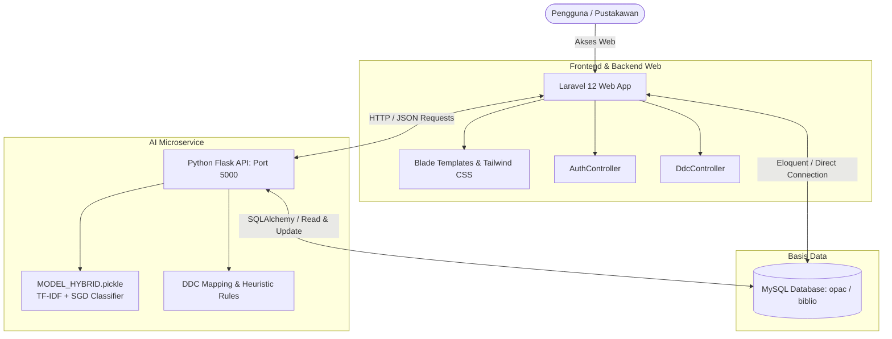

# E-DDC Library

> **Sistem Katalog Perpustakaan Cerdas (OPAC) Berbasis Dewey Decimal Classification (DDC) & Machine Learning Multilabel Rumpun Program Studi**

[](https://laravel.com)
[](https://www.python.org/)
[](https://flask.palletsprojects.com/)
[](https://scikit-learn.org/)
[](https://www.mysql.com/)
[](https://tailwindcss.com/)

---

## 📖 Tentang Proyek

**E-DDC Library** adalah platform katalog perpustakaan modern (*Online Public Access Catalog* - OPAC) yang mengintegrasikan kecerdasan buatan (*Machine Learning*) dengan sistem klasifikasi perpustakaan standar dunia (**Dewey Decimal Classification - DDC**). 

Sistem ini memecahkan masalah klasik pengkatalogan buku di institusi perguruan tinggi: **bagaimana mengelompokkan buku secara otomatis dan akurat ke dalam rumpun jurusan / program studi yang relevan**, bahkan ketika sebuah buku bersifat interdisipliner (*multilabel* lintas jurusan).

Dengan memadukan model **SGD Classifier (`modified_huber`)**, ekstraksi fitur **TF-IDF Vectorizer**, **Heuristic Keyword Boost**, serta **DDC Rule-based Sanity Check**, sistem mampu mengklasifikasikan lebih dari **8.740+ buku** dengan akurasi mencapai **~89%** dan menyaring label dengan tingkat keyakinan (*threshold*) relevan (>= 15%).

---

## Fitur Utama

- **Klasifikasi Multilabel Cerdas (Hybrid AI)**: Memprediksi rumpun ilmu buku dengan bobot probabilitas. Buku interdisipliner (seperti *IoT*, *Biomedis*, atau *Teknologi Bisnis*) dapat memiliki lebih dari satu label program studi dengan threshold probabilitas minimum **15%**.
- **Pencarian Katalog Fleksibel**:
  - Pencarian teks judul buku.
  - Pencarian kode spesifik DDC (misal: `005`, `621`).
  - Pencarian rentang kelas DDC (misal: `300-399`, `600-699`).
- **Filter Multi-Kategori Jurusan**:
  - Mendukung filter banyak jurusan secara sekaligus.
  - Pilihan mode kombinasi filter: **AND** (harus memenuhi semua jurusan terpilih) atau **OR** (memenuhi salah satu jurusan).
- **Dual Engine Mode**:
  - **Mode Database (Default / Super Cepat)**: Membaca hasil klasifikasi *pre-computed cache* di basis data MySQL untuk respon *sub-second*.
  - **Mode Realtime (AI Inference)**: Melakukan inferensi langsung secara dinamis melalui microservice Python Flask.
- **DDC Sanity Check & Exclusion Rules**:
  - Mencegah kontradiksi klasifikasi (misal: buku teknik mesin tidak akan keliru dilabeli sastra atau akuntansi).
  - Pemisahan domain tegas (misal: penanganan konflik domain Teknik vs Administrasi Niaga).
  - Aturan khusus buku *Internet of Things (IoT)* dan perangkat keras mikrokontroler.
- **Manajemen Buku (CRUD Lengkap)**:
  - Tambah buku baru dengan inferensi otomatis oleh AI.
  - Edit metadata buku beserta pembaharuan prediksi klasifikasi.
  - Hapus data buku dari katalog.
- **Autentikasi Pengguna**:
  - Sistem login dan register berbasis Laravel Auth untuk mengamankan fitur penambahan dan pengelolaan buku bagi staf / pustakawan.
- **Batch Processing Offline**:
  - Skrip otomatis untuk memproses ribuan buku dari basis data dan memperbarui kolom klasifikasi secara batch.

---

## Arsitektur Sistem

Sistem dibangun menggunakan pola *decoupled architecture* antara antarmuka web dan mesin inferensi AI:



---

## Rumpun Jurusan & Program Studi (Target Kelas)

Model AI memetakan buku ke dalam **12 kategori rumpun keilmuan / jurusan** (disesuaikan dengan kebutuhan akademik Politeknik):

| No | Rumpun / Jurusan | Deskripsi Cakupan & Pemetaan DDC |
|:---:|:---|:---|
| 1 | **Teknik Informatika & Komputer** | Pemrograman, rekayasa perangkat lunak, AI, jaringan, basis data (DDC `000-009`, `020-029`). |
| 2 | **Teknik Sipil** | Konstruksi, bangunan, struktur beton, mekanika tanah, hidrologi, ukur tanah (DDC `540-549`, `624-628`). |
| 3 | **Teknik Mesin** | Manufaktur, termodinamika, otomotif, pengelasan, perancangan mesin (DDC `600-609`, `620`, `629`, `660-669`). |
| 4 | **Teknik Elektro** | Elektronika, sistem tenaga, robotika, telekomunikasi, mikrokontroler (DDC `530-539`, `621.3`). |
| 5 | **Teknik Grafika & Penerbitan** | Jurnalistik, percetakan, desain grafis, fotografi, penerbitan (DDC `070-079`, `686`, `700-779`). |
| 6 | **Administrasi Niaga** | Manajemen, bisnis, pemasaran, logistik, perdagangan, perkantoran (DDC `330-339` umum, `380-389`, `650-659`). |
| 7 | **Akuntansi** | Akuntansi keuangan, perpajakan, audit, perbankan (DDC `332`, `336`, `657`). |
| 8 | **Matematika** | Aljabar, kalkulus, statistika, matematika diskrit (DDC `510-519`). |
| 9 | **Sains** | Fisika murni, kimia dasar, biologi (DDC `500-599` di luar matematika & rekayasa). |
| 10 | **Novel & Sastra** | Fiksi, puisi, prosa, kesusastraan Indonesia dan asing (DDC `800-899`). |
| 11 | **Psikologi** | Psikologi terapan, perilaku organisasi, kepribadian (DDC `150-159`). |
| 12 | **Umum** | Agama, filsafat umum, ilmu sosial dasar, hukum, ensiklopedia, kamus, dan karya umum lainnya. |

---

## Performa Model & Perbandingan Algoritma

Pengujian model dilakukan pada dataset perpustakaan (**8.740 data buku**) dengan skema *80% Training (6.992 buku)* dan *20% Hold-out Test Set (1.748 buku)* menggunakan fitur teks judul dan catatan katalog.

### Tabel Perbandingan Algoritma

| Model / Algoritma | Akurasi Test | Precision (Macro) | Recall (Macro) | F1-Score (Macro) | F1-Score (Weighted) | Kecepatan Uji |
|:---|:---:|:---:|:---:|:---:|:---:|:---:|
| **SGD Classifier + Heuristic Boost (Model Hybrid Terpilih)** | **89.07%** | **87.49%** | **83.78%** | **84.44%** | **88.96%** | **0.193 s** |
| **Linear Support Vector Machine (Linear SVC)** | 88.84% | 85.77% | 85.19% | 84.98% | 88.82% | 0.228 s |
| **SGD Classifier (Standar)** | 88.73% | 87.17% | 83.37% | 84.06% | 88.65% | 0.050 s |
| **Logistic Regression (LR)** | 84.44% | 79.79% | 82.51% | 80.36% | 84.47% | 0.792 s |
| **Multinomial Naive Bayes (MNB)** | 75.86% | 70.25% | 55.10% | 57.74% | 73.39% | 0.015 s |

> **Keunggulan Model Terpilih**: Kombinasi **SGD Classifier (`loss='modified_huber'`)** dengan **Heuristic Boost** menghasilkan estimasi probabilitas kalibrasi yang halus untuk penentuan multilabel, waktu komputasi yang sangat cepat, serta toleransi tinggi terhadap buku dengan judul pendek.

---

## Struktur Direktori Repositori

```text
E-DDC-Library/
├── app/
│   ├── Http/
│   │   └── Controllers/
│   │       ├── AuthController.php      # Autentikasi Pengguna (Login/Register/Logout)
│   │       ├── Controller.php          # Base Controller
│   │       └── DdcController.php       # Controller Pengelolaan Buku & Prediksi
│   └── Models/
│       └── User.php                    # Model User Eloquent
├── config/                             # Konfigurasi Laravel
├── database/                           # Migrasi & Seeder Database
├── dataset_opac_8740.csv               # Dataset Training & Verifikasi (8.740 buku)
├── public/                             # Public Web Assets
├── resources/
│   └── views/
│       ├── edit_buku.blade.php         # Tampilan Edit Buku
│       ├── hasil_klasifikasi.blade.php # Tampilan Hasil Pencarian & Filter Multilabel
│       ├── klasifikasi.blade.php       # Halaman Utama Katalog & Pencarian
│       ├── login.blade.php             # Halaman Login
│       ├── register.blade.php          # Halaman Registrasi Admin
│       └── tambah_buku.blade.php       # Formulir Tambah Buku Baru
├── routes/
│   └── web.php                         # Routing Laravel & Bridge HTTP ke Flask
├── Python_ai/
│   ├── api.py                          # Flask REST API Microservice (Port 5000)
│   ├── batch_predict.py                # Skrip Batch Prediction & Cache Generator
│   ├── train_model.py                  # Skrip Latih Ulang Model Hybrid
│   ├── requirements.txt                # Dependensi Pustaka Python
│   ├── MODEL_HYBRID.pickle             # Model Biner Terlatih (TF-IDF + SGD)
│   ├── eval_report.txt                 # Laporan Evaluasi Lengkap Model
│   └── perbandingan/                   # Skrip & Hasil Komparasi Algoritma
├── .env.example                        # Contoh Konfigurasi Environment
├── composer.json                       # Dependensi PHP (Laravel 12)
├── package.json                        # Dependensi Frontend (Tailwind CSS, Vite)
├── vite.config.js                      # Konfigurasi Bundler Vite
└── README.md                           # Dokumentasi Utama Proyek
```

---

## Kebutuhan Sistem

Sebelum memulai instalasi, pastikan lingkungan komputer Anda telah memenuhi prasyarat berikut:

- **PHP**: Versi `>= 8.2` (dengan ekstensi `pdo_mysql`, `mbstring`, `curl`, `openssl`).
- **Composer**: Versi `>= 2.x`.
- **Node.js & NPM**: Versi `>= 18.x`.
- **Python**: Versi `3.9` - `3.12`.
- **Database Server**: MySQL `>= 8.0` atau MariaDB `>= 10.4`.

---

## Panduan Instalasi & Menjalankan

Ikuti langkah-langkah di bawah ini untuk menyiapkan dan menjalankan proyek di lingkungan lokal:

### 1. Kloning Repositori & Persiapan Direktori

```bash
git clone https://github.com/username/E-DDC-Library.git
cd E-DDC-Library
```

### 2. Konfigurasi Environment (`.env`)

Salin file contoh konfigurasi dan sesuaikan pengaturan koneksi database Anda:

```bash
cp .env.example .env
```

Buka file `.env` dan pastikan pengaturan basis data telah sesuai dengan server MySQL lokal Anda:

```env
APP_NAME="E-DDC Library"
APP_ENV=local
APP_KEY=
APP_DEBUG=true
APP_URL=http://localhost:8000

DB_CONNECTION=mysql
DB_HOST=127.0.0.1
DB_PORT=3306
DB_DATABASE=opac
DB_USERNAME=root
DB_PASSWORD=
```

Buat database bernama `opac` di MySQL Anda:
```sql
CREATE DATABASE opac CHARACTER SET utf8mb4 COLLATE utf8mb4_unicode_ci;
```

### 3. Instalasi Dependensi Laravel & Migrasi

Jalankan instalasi paket PHP, buat application key, dan migrasikan tabel pengguna:

```bash
composer install
php artisan key:generate
php artisan migrate
```

### 4. Instalasi & Build Aset Frontend

```bash
npm install
npm run build
```

*(Atau jalankan `npm run dev` jika ingin melakukan pengembangan tampilan secara langsung).*

### 5. Setup Lingkungan Python (AI Microservice)

Sangat disarankan menggunakan virtual environment (*venv*):

```bash
# Masuk ke direktori Python_ai atau buat venv di root
python -m venv venv

# Aktivasi venv di Windows (PowerShell):
.\venv\Scripts\Activate.ps1

# Atau aktivasi venv di Linux / macOS:
source venv/bin/activate

# Pasang pustaka dependensi
pip install -r Python_ai/requirements.txt
```

> **Catatan Dependensi Python**: Pastikan pustaka berikut terinstal di *environment* Anda:
> `numpy`, `scikit-learn`, `flask`, `flask-cors`, `sqlalchemy`, `pymysql`, `python-dotenv`.

### 6. Inisialisasi Database & Prediksi Batch (Opsional / Pertama Kali)

Jika Anda ingin mengisi database `opac` dengan seluruh dataset buku dan menghitung *pre-computed multilabel classification* untuk 8.740+ buku:

```bash
python Python_ai/batch_predict.py
```

Skrip ini secara otomatis akan:
1. Memeriksa koneksi database MySQL `opac`.
2. Membuat kolom `predicted_jurusan`, `predicted_confidence`, dan `predicted_multilabel` pada tabel `biblio`.
3. Membaca model `MODEL_HYBRID.pickle` dan memproses klasifikasi seluruh buku secara batch.

---

## 🏃 Cara Menjalankan Aplikasi

Aplikasi membutuhkan dua server yang berjalan berdampingan: **Microservice Python Flask (AI)** dan **Web Server Laravel**.

### 1. Jalankan Microservice Python Flask

Buka terminal pertama dan jalankan:

```bash
python Python_ai/api.py
```
*Server API AI akan aktif di `http://127.0.0.1:5000`.*

### 2. Jalankan Web Server Laravel

Buka terminal kedua dan jalankan:

```bash
php artisan serve
```
*Aplikasi web utama dapat diakses melalui browser di: `http://127.0.0.1:8000`.*

*(Opsional)* Anda juga dapat menjalankan seluruh proses pengembangan (Vite + Laravel server) menggunakan perintah:
```bash
composer run dev
```

---

## 🔌 Dokumentasi REST API (Python AI Service)

Microservice Flask menyediakan endpoint publik yang digunakan oleh Laravel maupun sistem eksternal:

| Method | Endpoint | Deskripsi | Parameter Utama |
|:---|:---|:---|:---|
| `GET` | `/api/status` | Mengecek status server AI, akurasi model, dan daftar jurusan. | - |
| `GET` | `/api/buku/search` | Mencari buku dengan filter keyword, kode DDC, dan filter jurusan. | `keyword`, `filters`, `filter_mode` (`and`/`or`), `page`, `per_page`, `mode` (`database`/`realtime`) |
| `GET` | `/api/buku/detail/<id>` | Mengambil informasi detail sebuah buku berdasarkan ID. | `id` (biblio_id) |
| `POST` | `/api/buku/store` | Menyimpan buku baru dan mengklasifikasikan jurusan secara otomatis. | `title`, `classification`, `sor`, `notes`, dll. (JSON) |
| `PUT` | `/api/buku/update/<id>` | Memperbarui data buku dan memperbarui hasil prediksi AI. | `title`, `classification`, `sor`, `notes`, dll. (JSON) |
| `DELETE` | `/api/buku/delete/<id>` | Menghapus buku dari basis data katalog. | `id` (biblio_id) |

### Contoh Respon Prediksi Multilabel (`/api/buku/search`):

```json
{
  "biblio_id": 102,
  "title": "Internet of Things dengan Arduino dan NodeMCU",
  "classification": "004.678",
  "predicted_jurusan": "Teknik Informatika & Komputer",
  "predicted_confidence": 65.5,
  "multilabel": [
    {
      "label": "Teknik Informatika & Komputer",
      "probabilitas": 65.5,
      "metode": "hybrid_model"
    },
    {
      "label": "Teknik Elektro",
      "probabilitas": 34.5,
      "metode": "iot_rule"
    }
  ]
}
```

---

## Melatih Ulang Model AI (*Retraining*)

Jika terdapat penambahan dataset buku baru atau penyesuaian aturan mapping DDC:

1. Buka terminal di folder proyek.
2. Jalankan skrip training:
   ```bash
   python Python_ai/train_model.py
   ```
3. Skrip akan melakukan evaluasi *Stratified K-Fold Cross Validation*, pengujian pada *test set*, dan menyimpan model terbaru ke `Python_ai/MODEL_HYBRID.pickle`.
4. Perbarui data prediksi di database menggunakan:
   ```bash
   python Python_ai/batch_predict.py
   ```

---

## Kontribusi

Kontribusi untuk pengembangan fitur, perbaikan bug, atau penyempurnaan dataset sangat terbuka:

1. *Fork* repositori ini.
2. Buat *feature branch* baru: `git checkout -b fitur/fitur-keren-anda`.
3. *Commit* perubahan Anda: `git commit -m 'Menambahkan fitur keren'`.
4. *Push* ke branch Anda: `git push origin fitur/fitur-keren-anda`.
5. Buat sebuah **Pull Request**.

---

<p align="center">
  Dibuat untuk kemajuan sistem otomasi perpustakaan & literasi akademik.
</p>
